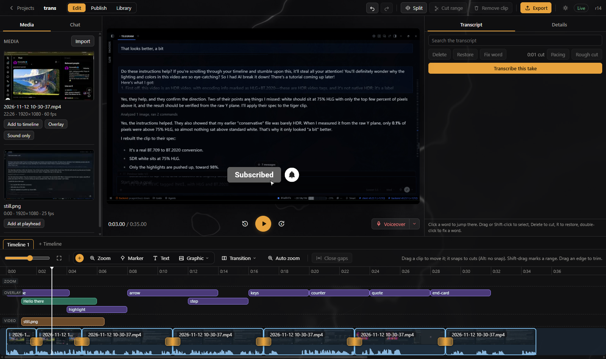

# Sous Chef for Hermes

Sous Chef is a local, agent-driven video editor for screen-recorded YouTube videos. This plugin
connects it to Hermes, so your agent can edit with you: cut by the words in the transcript, do a
rough cut you approve, add zooms, graphics and B-roll, write the title and description, make the
thumbnail, and export.



**You need the Sous Chef editor itself.** The plugin talks to the editor running on your computer
and does nothing on its own. Set it up from the main repository first:
<https://github.com/tonbistudio/sous-chef#run-it> (Node.js 22+, ffmpeg; developed and tested on
Windows). Open the Sous Chef app once so the plugin can find it.

## What it adds

- **Tools** (MCP server `sous_chef`): `project`, `transcript`, `edit_apply`, `suggest`, `frame_get`,
  `history`, `render`, `library`, `publish`. Every edit is one undo step in the editor and shows up
  there at once.
- **Skill** `sous-chef:video-editing`: how to edit with those tools: cut by the words, rough cuts
  that wait for your yes, voiceovers (lanes, splits, locking to the footage), zooms and graphics,
  B-roll, thumbnails with your exact title, and export.
- **A Sous Chef page** in the Hermes desktop app (sidebar and command palette) showing the editor.

The editor also learns how you like your cuts: after you finish a rough cut your way, **Teach
Hermes** in the transcript panel compares it with what Hermes suggested and writes the patterns into
a skill (`sous-chef-cut-lessons`) that later rough cuts follow.

## Install

```bash
hermes plugins install sous-chef
hermes plugins enable sous-chef
```

Then restart the gateway (or start a new session) so the tools load.

## What it does on your machine

- The tools and the desktop page talk only to the Sous Chef edit server on `127.0.0.1`, using the
  port and token the editor writes to its own folder (`%LOCALAPPDATA%\sous-chef` on Windows,
  `~/.local/share/sous-chef` elsewhere, or `SOUS_CHEF_HOME`).
- If the edit server is not running, the plugin starts it in the background from the location the
  Sous Chef app recorded (`install.json` in that folder). It stops on its own after 10 idle minutes.
- Your videos are never changed: edits live in the project folder, and exports are new files.
- The plugin itself makes no other network calls, stores no credentials and has no telemetry.
  Inside the editor, features you choose can reach out: Hermes for chat and rough cuts (your own
  provider), Imagination Studio on your machine for local B-roll, and your Hermes image and video
  tools for cloud B-roll (your provider's credits).

MIT licensed. Source: <https://github.com/tonbistudio/sous-chef>.
